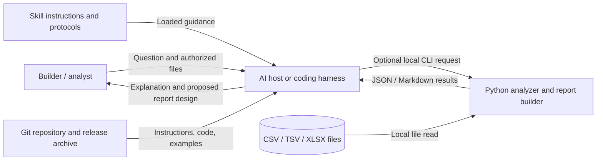

# High-level design: current repository and recommended boundary

**Status:** current-state review plus proposed guidance.  
**Source:** public repo files listed in the pilot README; current checkout at 2026-10-15.  
**Important:** repository-level design only. Not a hosted architecture or a production capacity certification.

## 1. Recommendation

Keep the current product as a portable instruction package plus optional local Python CLI helper unless user evidence shows a need for a hosted runtime. The codebase already has a useful separation between LLM instructions and deterministic calculations. There is no evidence in the repository for a network service, tenant system, database, or queue. **Do not add Kafka, microservices, Kubernetes, or horizontal scaling for this current product.** Those systems solve problems this repository has not demonstrated.

The first engineering priorities are accurate host-specific installation guidance, truthful result/status reporting, test coverage for supported behavior, and clear data-handling boundaries. Measure runtime and memory on representative authorized datasets before changing resource limits or parallelizing.

## 2. Context and architecture

**Observed components:**

| Component | Responsibility | Source evidence |
|---|---|---|
| Markdown skill and protocols | Tell a capable LLM how to inspect data, explain modeling, draft proposed formulas, and communicate limitations | `SKILL.md`, `SYSTEM_PROMPT.md`, `protocols/`, `references/` |
| Optional Python helper | Read supported files locally; inventory, audit declared keys, calculate constrained aggregates | `scripts/analyze.py`, `references/companion-runtime.md` |
| Report builder | Run configured helper analyses and create Markdown with COMPLETE/PARTIAL/FAILED/EMPTY status | `scripts/bi_report.py` |
| Example/fixture data | Demonstrate behavior with fabricated data | `examples/demo_sales/`, `tests/` |
| Release/test automation | Test on CI Python matrix and package explicit allowlisted files | `.github/workflows/tests.yml`, `scripts/build_archive.py`, `release-manifest.txt` |
| AI host | Loads instructions and, if available, can access attached files/code runtime; varies by provider | `docs/using-with-llms.md`; external to repository |

**Proposed context view (matches current documented workflow):**

This view does not claim every host can access the repo, attached files, Python runtime, or helper. Provider tools and data handling are outside this repository's control.

## 3. Key architecture decisions / alternatives

| Decision | Recommendation | Trade-off and revisit trigger |
|---|---|---|
| Product shape | Retain skill + optional local CLI | Portable and small operational footprint; revisit only if users need hosted collaboration or centralized execution |
| Execution | Keep helper synchronous/local for documented bounded work | Simple reproducibility, no network/queue operations; measure run time/RSS before optimizing |
| Compute scaling | Respect per-input guardrails; do not promise capacity | The helper materializes accepted rows in memory; if real workloads approach limits, benchmark first and compare chunking/streaming or an established analytics engine |
| Messaging | No queue/event broker in the current design | There are no demonstrated asynchronous jobs or durable event streams; add a simple job queue only if hosted work needs background execution; consider Kafka only with measured stream/replay needs and staffing |
| Persistence | Source files remain caller-controlled; no persistent application DB is evident | Avoids operating a data store; if future hosted service, define tenancy, retention, deletion, backups, and restore before choosing one |

## 4. Scaling and operations

The repo documents fixed input bounds and states they are conservative guardrails, not a measured performance envelope. XLSX input is further constrained by a compressed-package uncompressed size limit. The helper materializes accepted table rows for analysis. These facts support caution about memory, not a claim of failure at the threshold. No workload benchmarks were run in this pilot.

A proportionate next step for any observed slow run is to reproduce on synthetic/fabricated or explicitly authorized data while recording runtime, peak memory, row counts, and operation. If resource limits are reached, report an explicit controlled error; do not silently truncate. Only propose larger machines or partitioned/parallel work after measurement identifies a bottleneck and correctness tests cover it.

## 5. Security and ownership

The current package has no user-auth or tenancy layer because no service is evident. The local helper's documented non-transmission and opt-in sample behavior reduce data movement, but derived values may remain sensitive. The AI host may receive uploaded data, so its privacy and file-access settings remain a separate boundary. See the pilot DFD and risk plan.
