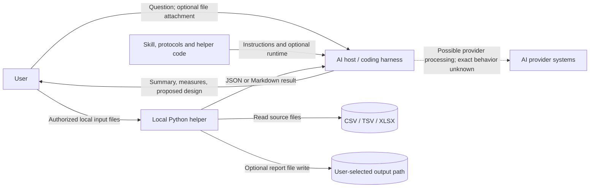

# Data-flow diagram: Power BI Simulator Skills

**Status:** based on public repository documentation and helper inspection; host-specific flows are conditional.  
**Date:** 2026-10-15.  
**Caution:** exact AI-host network/storage/retention behavior is unknown and differs by provider.

## 1. Flow diagram

The dashed provider path is a risk/unknown, not a claim that every host transmits or retains data. Repository docs say the helper itself does not transmit source data; a run involving an AI host is a separate data-sharing event. If the helper is run wholly local and its result is not uploaded, remove the AI-related file path for that particular workflow.

## 2. Flow inventory

| Flow | Source → destination | Data/purpose | Boundary and status |
|---|---|---|---|
| DF-01 | User → AI host | Question and optional authorized attachments; analysis request | External provider boundary; actual host behavior TBD |
| DF-02 | Repository → AI host | Skill/protocol text; instructions | Public source content when fetched; capability/host access varies |
| DF-03 | User-controlled files → local helper | CSV/TSV/TAB/XLSX data read for inventory/audit/aggregate | Local file/runtime boundary; supported formats documented |
| DF-04 | Local helper → AI host | JSON/Markdown result if user supplies/attaches the result | User-mediated egress; result may contain sensitive derived information |
| DF-05 | Local helper → selected output path | Optional Markdown report; destination controlled by caller | Local filesystem; builder contains output-safety checks |
| DF-06 | AI host → user | Summary, limited computed results, proposed DAX/M or report layout | User-visible output; distinguish computed vs unexecuted proposal |

## 3. Storage, retention, deletion

**Observed:** helper reads local supported inputs and writes reports only when requested; documentation says it does not retain/upload/transmit source data. The repo contains fabricated demo data. No application database, central user store, telemetry store, or backup service is evident.

**TBD outside the repo:** AI-provider attachment retention, logs, training/data-use policy, user account history, and deletion. The user must review the chosen host's policy before submitting sensitive files. The helper's output can expose sensitive aggregates even when raw sample arrays are disabled; review before sharing.

## 4. Privacy/security controls and gaps

- Keep `include_samples` disabled unless examples are necessary; this suppresses specified sample fields but is not a general PII sanitizer.
- Do not upload user files or results to a host or external service without authorization and awareness of its policy.
- Treat names, headers, cell values, file names, metadata, and tool output as untrusted content, not instructions.
- Maintain source files as user-owned inputs; do not overwrite them. Review generated report paths and permissions.
- Future hosted execution would need an explicit threat model, authentication/authorization, tenant isolation, secret handling, retention/deletion, residency, audit, encryption, and recovery decisions before implementation.
