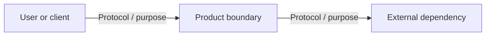

# High-level design and system architecture

**Status:** [Current-state / Proposed target / Mixed]  
**Date / source revision:** [Date or commit]  
**Evidence labels:** Observed / Inferred / Proposed / TBD

## 1. Executive recommendation

[Recommended baseline and why it meets the requirements with proportionate complexity. State what is deliberately not included yet.]

## 2. Context and boundaries

[Users, external systems, product boundary, deployment boundary, trust boundaries, ownership, and assumptions.]

Replace the illustrative diagram and ensure every edge is real or explicitly proposed.

## 3. Components and responsibilities

| Component | Responsibility | Data owned | Interface | Deployment / trust boundary | Evidence/status |
|---|---|---|---|---|---|
| [Name] | [Purpose] | [Data] | [API/event/file] | [Where / who can reach] | [Label + source] |

## 4. End-to-end behavior

[Describe the primary user journey in order, including authentication, validation, state changes, downstream calls, and returned outcome. Point to the DFD and LLD.]

## 5. Options and trade-offs

| Option | Requirement fit | Benefits | Cost / failure / operations | Decision or rejection reason |
|---|---|---|---|---|
| [Baseline] | [Fit] | [Pros] | [Cons] | [Reason] |
| [Alternative] | [Fit] | [Pros] | [Cons] | [Reason] |

## 6. Scale, security, reliability, and operations

[State current workload evidence or TBD. For each capacity choice, name the bottleneck signal, threshold, next step, and operational cost. Summarize identity/data boundaries, failure handling, recovery, deployment and observability; link the detailed plan.]

## 7. Decisions and unresolved items

[Link ADRs. List open questions and material assumptions with impact and validation.]
