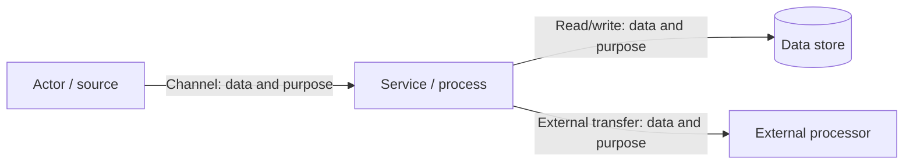

# Data-flow diagram and lifecycle

**Status:** [Current-state / Proposed target / Mixed]  
**Data classification:** [Known categories or TBD]  
**Date / source revision:** [Date or commit]

## 1. Diagram

Use one diagram per meaningful trust boundary if a single diagram becomes unreadable. Name data types rather than showing sensitive example values. Label each arrow with protocol/channel and purpose; use dashed/colored subgraphs only when their meaning is also explained in prose.

Replace the illustrative nodes/edges. Make Internet, private network, tenant, device, and third-party boundaries explicit where relevant.

## 2. Flow inventory

| Flow ID | Source → destination | Data category | Protocol / purpose | Trust boundary | Encryption/access | Evidence/status |
|---|---|---|---|---|---|---|
| DF-01 | [Source → destination] | [Data] | [Channel/purpose] | [Boundary] | [Controls or TBD] | [Observed/proposed/TBD] |

## 3. Storage and lifecycle

| Store / copy | Source of truth? | Data held | Retention / deletion | Backup / recovery | Access owner |
|---|---|---|---|---|---|
| [Store] | [Yes/no] | [Category] | [Policy/target or TBD] | [Plan or TBD] | [Owner/TBD] |

Address caches, logs, analytics, telemetry, backups, exports, and third-party/model-provider processing where applicable. A diagram omitting those paths is incomplete if they exist.

## 4. Privacy and threat notes

[Explain least privilege, tenant separation, data minimization, consent/notice, residency, deletion propagation, and likely abuse paths proportionate to the risk. Separate controls present today from proposed controls.]

## 5. Review checks

[Confirm each input, transformation, store, and egress in the prose and component design; identify unknowns; do not insert real credentials, private records, or unnecessary identifiers.]
