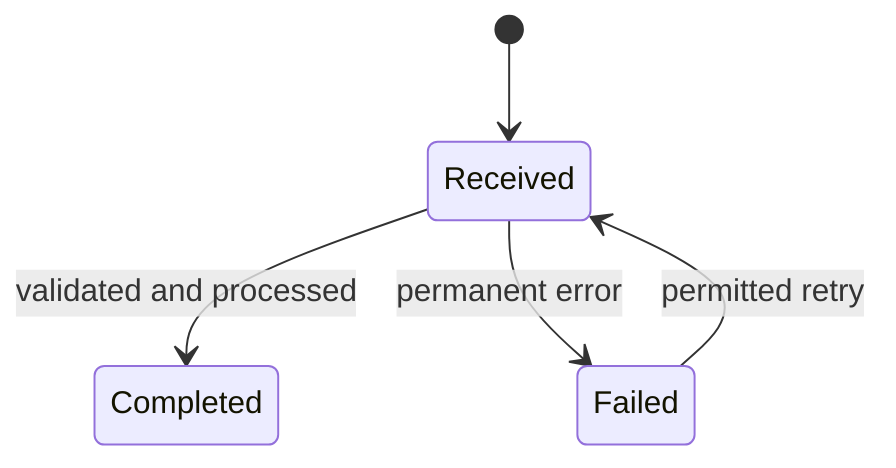

# Low-level design

**Status:** [Current-state / Proposed target / Mixed]  
**Date / source revision:** [Date or commit]  
**Linked requirements:** [FR/NFR IDs]

## 1. Component/module contracts

| Component | Responsibility | Inputs / outputs | Data owned | Dependencies | Authorization / failure boundary |
|---|---|---|---|---|---|
| [Name] | [Purpose] | [Contract] | [State] | [Dependencies] | [Controls / error handling] |

## 2. Interface/API/event/file contracts

For each important interface, record protocol and version, authentication/authorization, request/response or event schema, validation, size/rate limits, error codes, timeout, retry policy, idempotency key, ordering, and compatibility strategy. Do not say “exactly once” without explaining the mechanism and failure model.

| Interface | Caller → owner | Contract/version | Auth | Errors / timeout / retry | Idempotency / compatibility |
|---|---|---|---|---|---|
| [Name] | [Caller → owner] | [Link/schema] | [Policy] | [Behavior] | [Plan] |

## 3. Data model and state transitions

[Entities, grain, keys/constraints, indexes justified by access patterns, relationships, consistency/transaction boundary, lifecycle, migration/backfill and rollback. Include state transitions for long-running or asynchronous work.]

Replace the illustrative state machine where relevant; label retry limits and terminal states in prose.

## 4. Critical sequence and failure paths

[Describe success and the important invalid-input, unauthorized, duplicate, dependency-timeout, overload, partial-failure, and recovery behaviors. Specify deadlines, bounded retries/backoff, deduplication, compensating action, and user-visible state.]

## 5. Deployment/runtime details

[Runtime/process boundaries, configuration, secrets, health checks, resource limits, graceful shutdown, schema/config migration order, rollout/rollback, compatibility with old clients, and ownership. Mark unknowns.]

## 6. Verification

[Map each critical contract, NFR, and failure path to unit/integration/contract/security/load/recovery/user-acceptance tests. State the environment and what each test cannot prove.]
